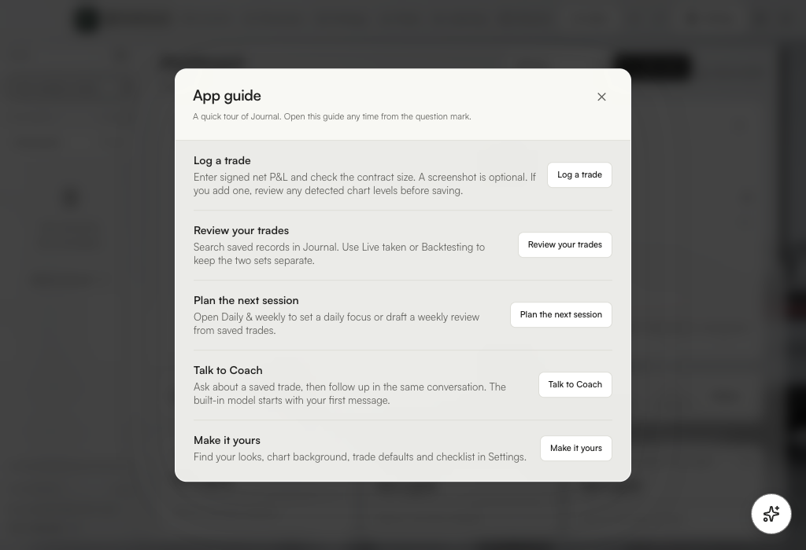
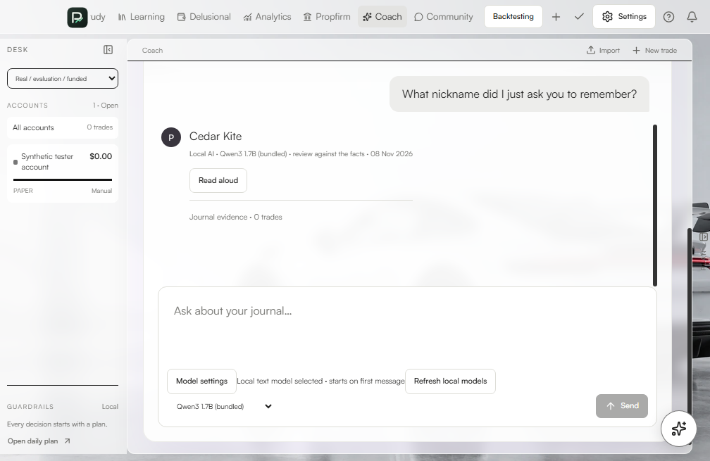
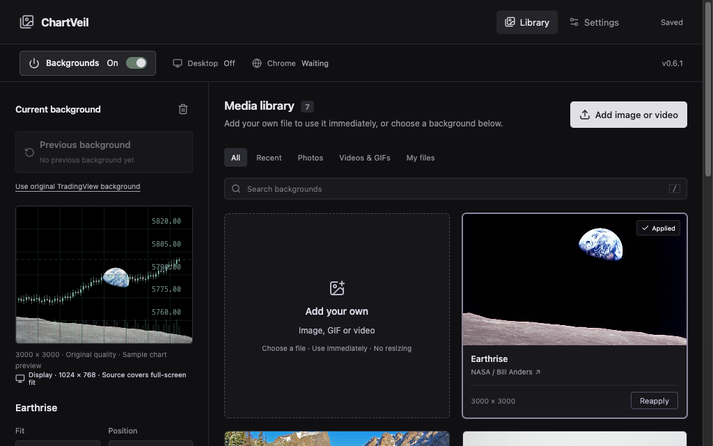

# Install Journal and ChartVeil

Each download is about 1.65 GB and includes both desktop apps and the local Coach model. Allow room for both the download and the installed apps. Download from the [Beta 4 release](https://github.com/PopetoNM/proffitability-journal-releases/releases/tag/v0.4.0-beta.4).

[Mac](#mac-with-apple-silicon) · [Windows](#windows-11-or-later-on-x64) · [Verify the download](#verify-the-download) · [Check the installation](#check-the-installation) · [ChartVeil](#chartveil)

## Mac with Apple Silicon

1. Open **Apple menu → About This Mac**. The **Chip** field should name an Apple chip such as M1 or M2.
2. [Download the Mac disk image](https://github.com/PopetoNM/proffitability-journal-releases/releases/download/v0.4.0-beta.4/Proffitability-Journal-Mac-arm64.dmg). Wait until the `.dmg` finishes downloading.
3. In Finder, open **Downloads** and double-click **Proffitability-Journal-Mac-arm64.dmg**.
4. In the window that opens, drag the **PROFFITABILITY JOURNAL** folder onto the **Applications** shortcut. Wait for Finder to finish copying.
5. Open **Finder → Applications → PROFFITABILITY JOURNAL**. Open **PROFFITABILITY JOURNAL** and **ChartVeil** from there. Eject the installer disk image after the copy is complete.

**If macOS says the developer cannot be verified**, compare the SHA-256 below first. For the matching Beta 4 file, Apple’s app-specific approval is under **System Settings → Privacy & Security → Open Anyway** after you first try to launch the app. A warning that the app is damaged calls for a fresh download and another checksum check. [Apple’s first-launch instructions](https://support.apple.com/en-us/102445)



## Windows 11 or later on x64

1. In **Settings → System → About**, check **System type** for an x64-based processor and **Windows specifications** for Windows 11.
2. [Download Windows Setup](https://github.com/PopetoNM/proffitability-journal-releases/releases/download/v0.4.0-beta.4/Proffitability-Journal-Windows-x64-Setup.exe). Wait until the `.exe` finishes downloading.
3. In File Explorer, open **Downloads** and double-click **Proffitability-Journal-Windows-x64-Setup.exe**. Use your regular Windows account.
4. Select **Install** and wait for the progress bar to finish. Select **Finish**. Setup may offer to open Journal immediately.
5. Open **Start** and search for **PROFFITABILITY JOURNAL** and **ChartVeil**. Each has its own shortcut. Windows lists the suite under **Settings → Apps → Installed apps** as **PROFFITABILITY JOURNAL**.

**If Windows shows a publisher warning**, check the source and SHA-256 before deciding whether to run the unsigned tester beta. Smart App Control or a work or school policy can block unsigned apps outright. Ask your administrator about that device’s policy if you’re on a managed PC. [Microsoft’s Smart App Control guide](https://support.microsoft.com/en-us/windows/security/threat-malware-protection/smart-app-control-frequently-asked-questions)

## Verify the download

Compare the 64-character SHA-256 from the command with the checksum for the same file on the release page. A mismatch means you should discard that download and get a fresh copy. [Beta 4 checksums](https://github.com/PopetoNM/proffitability-journal-releases/releases/tag/v0.4.0-beta.4)

**Mac Terminal**

```sh
shasum -a 256 "$HOME/Downloads/Proffitability-Journal-Mac-arm64.dmg"
```

**Windows PowerShell**

```powershell
(Get-FileHash "$env:USERPROFILE\Downloads\Proffitability-Journal-Windows-x64-Setup.exe" -Algorithm SHA256).Hash
```

If you moved or renamed the installer, use its actual path in the command.

## Check the installation

1. Open Journal and confirm the dashboard loads. Open the **?** button for the tour.
2. Open **Coach**, select **Qwen3 1.7B (bundled)**, and send “Hello.” The first response can take longer while the local model loads.
3. Open ChartVeil and choose **Apply** on a built-in image. Confirm the preview changes. Use the steps below if you also want the background on a TradingView chart.

If the download stalls, check free storage and retry from the release page. If an app will not start, note the exact warning and your OS version before reporting it. When upgrading, use **Settings → Data & backup** in Journal to make a backup, then quit both apps before replacing the Mac folder or rerunning Windows Setup.

The public Beta 4 files were freshly downloaded and checked by SHA-256 on hosted Apple Silicon and Windows x64 machines. The Mac check verified the disk image, copied both apps, and opened them. The Windows check ran Setup, checked both Start shortcuts, opened both apps, and ran the uninstaller. Both platforms also passed the installed Journal checks for chart reading, screenshot-free trade logging, Coach follow-ups, and exports.

## First trade and Coach

Open the **?** button in Journal for shortcuts. To log a trade, choose Live taken or Backtesting, then **New trade**. Enter signed net P&L and choose Micro or Mini. Setup, notes, checklist, and screenshots are optional. If you attach a full TradingView chart, review the detected entry, stop, and target before saving. You can save with any unreadable fields left blank.

Open **Coach** and send a message with the bundled model selected. The first reply can take longer while the model loads. Follow up in the same conversation, or choose **Read aloud** beneath a reply to use your device’s voice. The screen below shows fictional data.



Open **Settings → Appearance** to choose Obsidian, Graphite, or High contrast. Select the preset and choose **Apply selected look**. Edit your defaults in **Settings → Trade logging**.

## ChartVeil

Open ChartVeil and choose **Apply** on a background, or add your own photo, GIF, or video. Adjust fit, position, and opacity in the preview. **Backgrounds Off** restores the chart's original appearance.

- **Chrome on Mac or Windows.** In ChartVeil, go to **Settings → Open extension folder**. On Chrome's Extensions page, enable **Developer mode**, choose **Load unpacked**, and select that folder. Open a TradingView chart. This is a one-time setup for each browser profile.
- **TradingView Desktop.** Enable **Automatic TradingView backgrounds** in ChartVeil. Mac presents a connection prompt. On Windows, true Desktop replacement uses an optional local connection. The Chrome setup above is the guided chart-background path on Windows.


