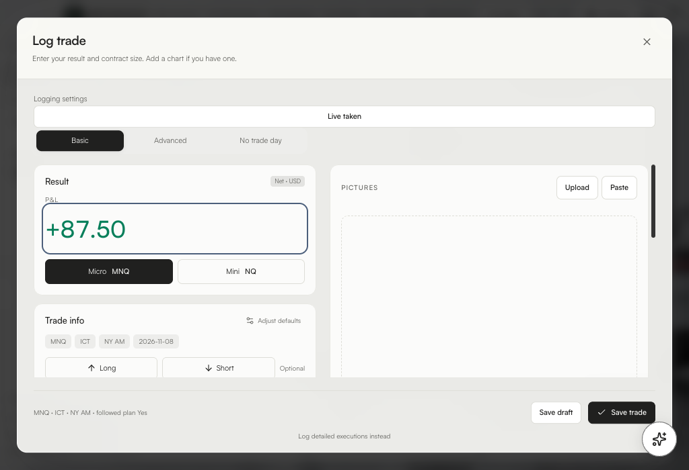

# PROFFITABILITY JOURNAL + ChartVeil

Two desktop apps and a built-in offline model in each download.

- **PROFFITABILITY JOURNAL** for quick trade logging with optional screenshots, separate Live and Backtesting records, and daily and weekly reviews. The included Qwen3 1.7B text model runs Coach conversations and weekly review drafts on your device.
- **ChartVeil** for local chart backgrounds with automatic display detection and original-resolution media.

[Mac download and setup](https://popetonm.github.io/proffitability-journal-releases/mac/) · [Windows download and setup](https://popetonm.github.io/proffitability-journal-releases/windows/) · [Illustrated app guide](https://popetonm.github.io/proffitability-journal-releases/guide/) · [Release and checksums](https://github.com/PopetoNM/proffitability-journal-releases/releases/tag/v0.4.0-beta.4)

[Watch the 15-second product trailer](https://popetonm.github.io/proffitability-journal-releases/#trailer)

**Mac** — Open the DMG, drag the **PROFFITABILITY JOURNAL** folder onto **Applications**, then open either app from that folder.

**Windows** — Run **Setup**, then open Journal or ChartVeil from **Start**.

These are beta installers. macOS may ask for first-launch approval and Windows may display a publisher warning. [Apple's first-launch instructions](https://support.apple.com/en-us/102445)

Open the **?** button in Journal for the walkthrough. Open **Coach** and send a message to load the included model. For ChartVeil and its optional Chrome connection, follow the [installation and setup guide](INSTALL.md).

For feedback, send Plamen the app, operating system, steps, expected result and what happened. Remove account information and private trade details from screenshots.

Journal uses FFmpeg 9.0.2 under LGPL 2.1 or later. [FFmpeg source and Mac build recipe](https://github.com/PopetoNM/proffitability-journal-releases/releases/download/v0.4.0-beta.3/FFmpeg-9.0.2-clean-source.zip) · [Windows build recipe](docs/third-party/ffmpeg-windows-build.sh) · [Qwen3 weights](https://huggingface.co/ggml-org/Qwen3-1.7B-GGUF) · [Tesseract English OCR weights](https://github.com/tesseract-ocr/tessdata_fast/tree/87416418657359cb625c412a48b6e1d6d41c29bd)

These independent tools are unaffiliated with TradingView.
