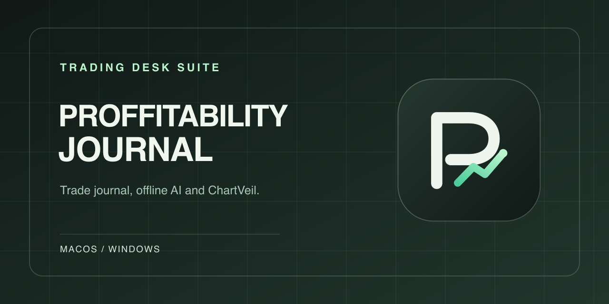

# PROFFITABILITY JOURNAL + ChartVeil

Two desktop apps and a built-in offline model in each download.

- **PROFFITABILITY JOURNAL** for screenshot-first trade logging, separate Live and Backtesting records, and daily and weekly reviews. The included Qwen3 1.7B text model runs Coach and weekly review drafts locally.
- **ChartVeil** for local chart backgrounds with automatic display detection and original-resolution media.

[Download for Mac · Apple Silicon](https://github.com/PopetoNM/proffitability-journal-releases/releases/download/v0.4.0-beta.3/Journal-ChartVeil-Mac-arm64-clean.zip) · [Download for Windows · x64](https://github.com/PopetoNM/proffitability-journal-releases/releases/download/v0.4.0-beta.3/Journal-ChartVeil-Windows-x64.zip) · [Release and checksums](https://github.com/PopetoNM/proffitability-journal-releases/releases/tag/v0.4.0-beta.3)

Extract the full ZIP and open **START HERE.txt**. Choose Apple Silicon Mac or Windows x64. Mac uses an ad hoc signature and Windows may display a publisher warning. [Apple's first-launch instructions](https://support.apple.com/en-us/102445)

Open Journal and ask a question in **Coach** to start the bundled model. Open ChartVeil and choose **Settings → Connect TradingView Desktop** on Mac. On Windows, choose **Settings → Open extension folder** and load that folder through Chrome's Extensions page. Journal exports PNG on both systems, plus GIF and MP4 on Mac.

For feedback, send Plamen the app, operating system, steps, expected result and what happened. Remove account information and private trade details from screenshots.

The release includes the Mac encoder's corresponding FFmpeg source and build recipe. Third-party notices ship with the software. [Qwen3 weights](https://huggingface.co/ggml-org/Qwen3-1.7B-GGUF) · [Sharp libvips source](https://github.com/lovell/sharp-libvips)

These are independent tools and are unaffiliated with TradingView or Discord.
